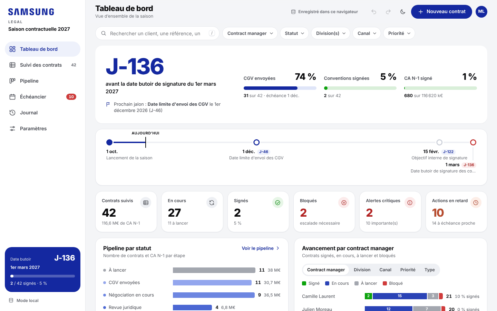

# Suivi de la saison contractuelle 2027

Application web de suivi des négociations annuelles (CGV, conventions L441-3, échéances, signatures),
pensée pour remplacer le fichier Excel de suivi et permettre à plusieurs contract managers de le
**modifier en même temps**. Elle est publiée sur GitHub Pages et s'appuie sur Firebase pour le partage en
temps réel.



## Fonctionnalités

- **Tableau de suivi façon Excel** : édition dans les cellules, navigation au clavier, copier-coller avec
  Excel, tri, filtres de colonne, regroupement, sélection multiple et actions groupées, annulation (Ctrl+Z).
- **Travail simultané** : les modifications de chacun apparaissent chez les autres en temps réel, champ par
  champ, avec indication de qui est en ligne et de qui modifie quoi ; fonctionnement hors connexion.
- **Tableau de bord** : compte à rebours jusqu'à la date butoir du 1er mars, jauges CGV / signatures / CA,
  frise des jalons, pipeline, avancement par contract manager, division ou canal, rythme de signature.
- **Alertes** sur les échéances légales (art. L441-3 du Code de commerce : CGV au plus tard trois mois avant
  le 1er mars, convention au plus tard le 1er mars), les actions en retard et les blocages.
- **Pipeline** par glisser-déposer, **échéancier** des actions et diagramme de Gantt de la saison.
- **Fiche contrat** : étapes du statut, commentaires partagés, historique, relances par e-mail pré-remplies.
- **Journal** complet et inaltérable de toutes les modifications.
- **Paramétrable sans code** : jalons, équipe, statuts et listes, colonnes, automatisations, modèles d'e-mails.
- **Import** du fichier Excel (y compris par copier-coller depuis un fichier protégé par DRM), **export**
  Excel mis en forme, CSV, PDF, sauvegarde et restauration complètes.
- Charte Samsung (bleu Samsung, blanc, boutons en pilule), thème clair et sombre, utilisable sur ordinateur,
  tablette et téléphone.

## Démarrer

- **Mise en ligne et configuration Firebase** : [docs/MISE-EN-LIGNE.md](docs/MISE-EN-LIGNE.md)
- **Guide des contract managers** : [docs/GUIDE-UTILISATEUR.md](docs/GUIDE-UTILISATEUR.md)

Sans configuration, l'application fonctionne en **mode local** (données enregistrées dans le navigateur,
non partagées) : pratique pour la découvrir, avec des données de démonstration fictives.

Pour l'essayer sur un poste : ouvrir un terminal dans le dossier et lancer `npx http-server site`, puis
ouvrir l'adresse indiquée.

## Organisation du dépôt

```
site/                     application publiée sur GitHub Pages
  index.html, config.js   page et configuration (Firebase, saison)
  assets/css/app.css      charte graphique
  assets/js/core/         données, calculs, alertes, stockage local et Firebase, Excel
  assets/js/ui/           composants (pastilles, calendrier, graphiques, fenêtres)
  assets/js/views/        vues (tableau de bord, suivi, pipeline, échéancier, journal, paramètres)
  vendor/                 Firebase et ExcelJS embarqués (aucun CDN externe)
firebase/firestore.rules  règles de sécurité de la base
docs/                     guides
tests/                    tests unitaires, parcours navigateur, synchronisation à deux utilisateurs
tools/                    reconstruction des dépendances embarquées
```

## Qualité

- 27 tests unitaires (calculs d'alertes, dates, import Excel, automatisations, annulation, renommage de listes,
  pagination du journal) ;
- 33 étapes de test dans un vrai navigateur (édition, collage Excel, tri, filtres, fiche, pipeline, paramètres,
  import / export, sauvegarde, mobile) ;
- 21 étapes de test à **deux utilisateurs simultanés** sur l'émulateur Firebase (temps réel, modifications
  concurrentes, présence, hors ligne, suppressions concurrentes, refus d'accès, journal inaltérable) ;
- audit d'accessibilité automatique (axe-core) sans violation WCAG A/AA, en thème clair et sombre.
