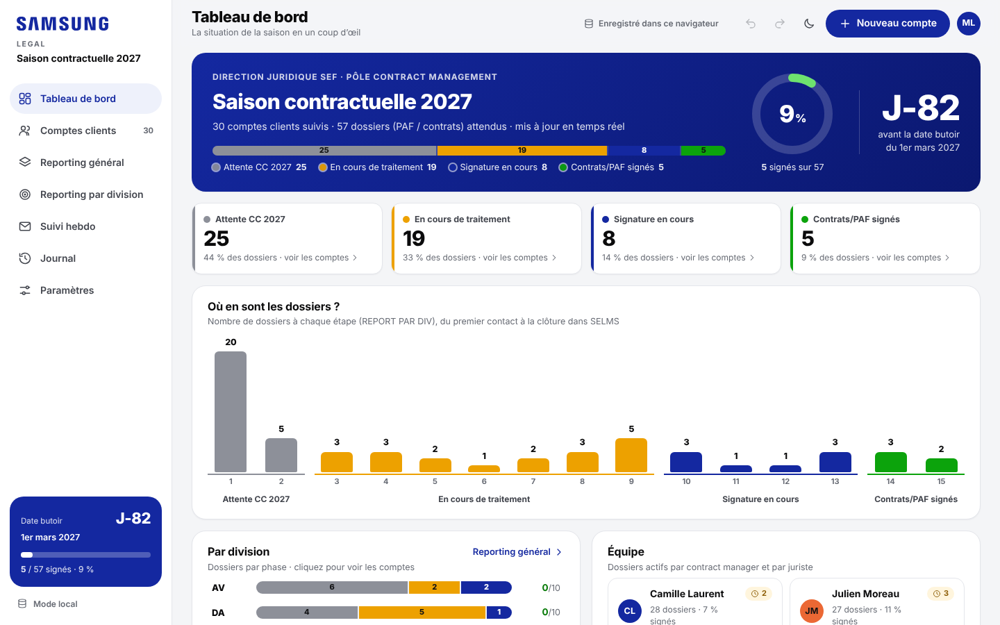
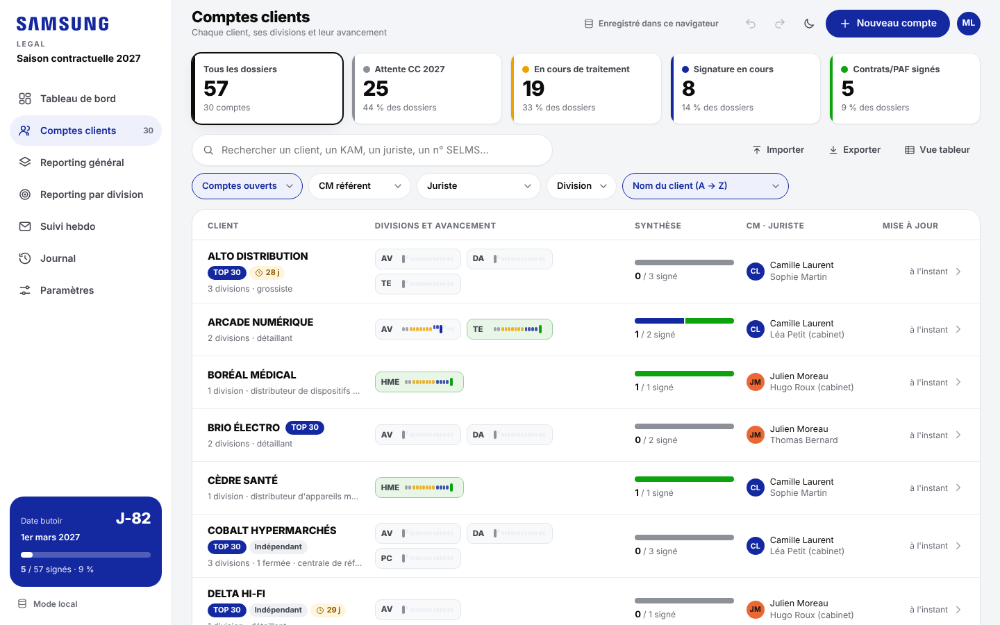
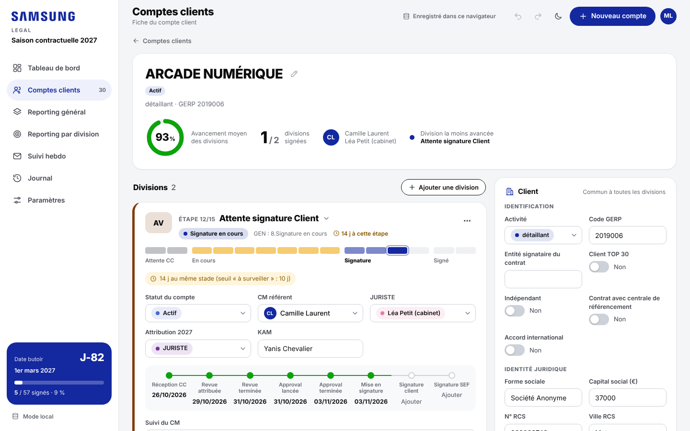
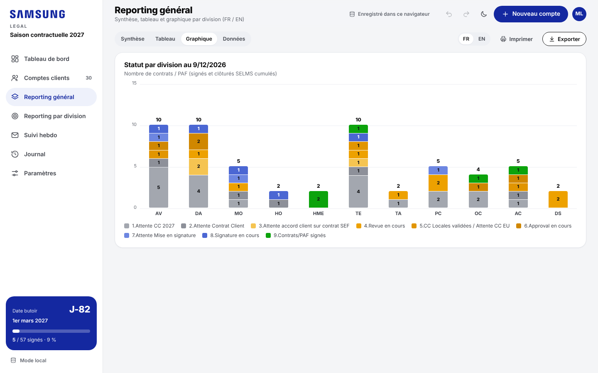
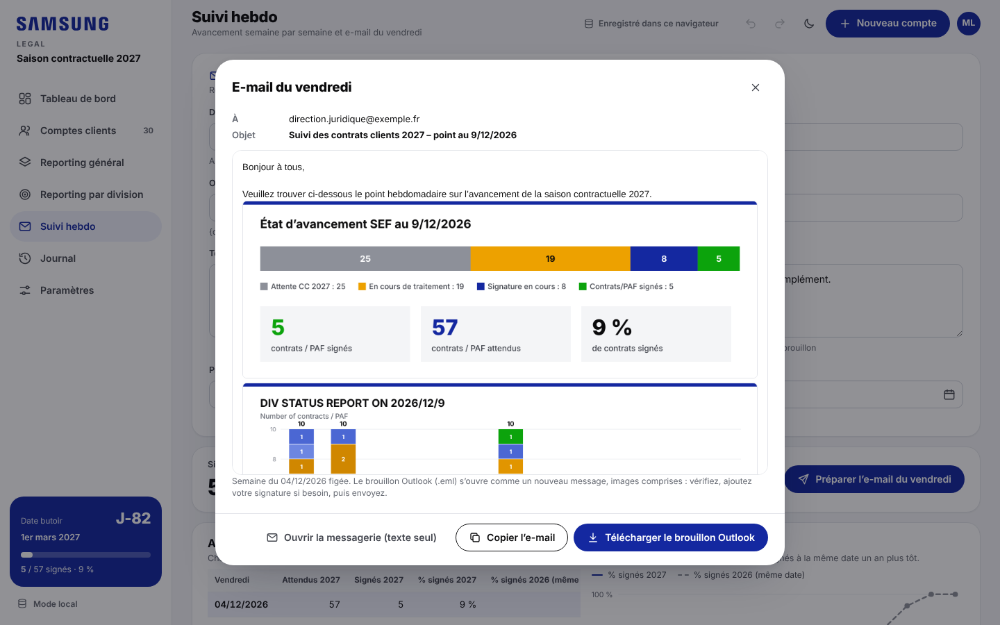

# Guide des contract managers

L'outil suit la saison contractuelle **compte client par compte client**. Chaque client regroupe ses
divisions ; pour chaque division, on renseigne une seule chose au quotidien : **son étape** (REPORT PAR DIV).
Tout le reste en découle : REPORT GEN, couleurs, tableau de bord, reportings. Les deux contract managers
travaillent en même temps sur les mêmes données ; les modifications de chacun apparaissent chez l'autre en
quelques secondes.

## Les écrans

| Écran | À quoi il sert |
|---|---|
| **Tableau de bord** | La situation de la saison en un coup d'œil : compte à rebours jusqu'au 1er mars, dossiers par phase, nombre de dossiers à chaque étape, avancement par division, par CM et par juriste, dossiers qui n'avancent plus, activité récente de l'équipe, notes partagées. Tout est cliquable. |
| **Comptes clients** | La liste des clients, une ligne par client, avec ses divisions et leur avancement. Recherche, filtres, tri. Un clic ouvre la fiche du compte. |
| **Fiche du compte** | Tout ce qui concerne un client : ses divisions et leur étape, l'équipe, les jalons, les notes, les informations du client, les échanges de l'équipe. |
| **Reporting général** | Synthèse, tableau TOTAL SEF / CE / IM, graphique par division en français ou en anglais. |
| **Reporting par division** | Une division (ou un CM, un juriste) : répartition par étape et liste de ses dossiers. |
| **Suivi hebdo** | Avancement semaine par semaine et e-mail du vendredi prêt à envoyer. |
| **Journal** | Qui a modifié quoi et quand. |

## L'étape : REPORT PAR DIV, et REPORT GEN qui en découle

Le parcours d'un dossier compte 15 étapes REPORT PAR DIV, regroupées en 4 phases de couleur :

| Phase | Étapes REPORT PAR DIV | REPORT GEN correspondant |
|---|---|---|
| **Attente CC** (gris) | 1. Attente CC · 2. Attente contrat client | 1 · 2 |
| **En cours de traitement** (orange) | 3. Revue juriste/CM · 4. Revue client · 5 à 7. Attente retour DIV (PAF, annexe, contrat) · 8. CC locales validées · 9. Approval en cours | 4 · 3 · 4 · 5 · 6 |
| **Signature** (bleu) | 10. Attente mise en signature · 11 à 13. Attente signature (client/SEF, client, SEF) | 7 · 8 |
| **Signé** (vert) | 14. Contrats/PAF signé · 15. Clôturé SELMS | 9 · 10 |

On ne saisit **que l'étape** : REPORT GEN est mis à jour automatiquement, ainsi que la date « Statut modifié
le » (qui sert à repérer les dossiers qui n'avancent plus). La correspondance se règle dans
**Paramètres › Listes de valeurs › Étapes (REPORT PAR DIV)**.

## Comptes clients

- En haut, les **dossiers par phase** : un clic filtre la liste (ex. « Signature en cours »).
- **Recherche** : nom du client, KAM, juriste, n° SELMS, code GERP… sans se soucier des accents.
- **Filtres** : comptes ouverts / mes comptes / tous / fermés, CM référent, juriste, division ; **tri** par
  nom, avancement, dernière mise à jour, ou dossiers restés le plus longtemps à la même étape.
- Chaque ligne montre les divisions du client avec une **petite barre de progression** (survolez-la pour lire
  l'étape), la synthèse des divisions signées, le CM et le juriste, la dernière mise à jour. Le pictogramme
  horloge signale un dossier resté longtemps à la même étape.
- **Nouveau compte** (bouton en haut à droite) : saisissez le nom du client, puis choisissez sa division dans
  la fiche.

## La fiche du compte

- **En-tête** : nom du client (crayon pour le renommer), statut, TOP 30, indépendant…, avancement moyen,
  nombre de divisions signées, équipe, division la moins avancée.
- **Une carte par division** :
  - **changer d'étape** : cliquez directement sur la barre de progression, ou sur le nom de l'étape pour
    choisir dans la liste ;
  - statut du compte, CM référent, juriste, attribution 2027, KAM ;
  - **jalons** (réception CC, revue, approval, signatures) : cliquez sur un jalon pour le dater ; une date
    incohérente avec les précédentes apparaît en rouge ;
  - **suivi du CM** : la note libre du dossier ;
  - **Plus d'informations** : dossier, contrat, signature et saison 2026 ;
  - menu « … » : toutes les informations de la ligne, fermer ou rouvrir la division, la supprimer.
- **Ajouter une division** : les informations du client, le CM et le juriste sont repris automatiquement.
- **Client** (à droite) : activité, code GERP, identité juridique… saisis **une seule fois** pour toutes les
  divisions du client.
- **Échanges de l'équipe** : commentaires, rattachés à une division ; **Activité récente** : les dernières
  modifications du compte.

## Reportings et e-mail du vendredi

- **Reporting général** : synthèse, tableau (TOTAL SEF, CE, IM et chaque division, puis le détail par REPORT
  GEN), graphique par division en **français ou en anglais**, impression ou export Excel.
- **Reporting par division** : choisissez une division, un CM ou un juriste ; répartition par étape et liste
  des dossiers, du moins avancé au plus avancé.
- **Suivi hebdo** : renseignez une fois les destinataires et les textes ; le vendredi, **Préparer l'e-mail
  du vendredi** fige la semaine et prépare l'e-mail avec la synthèse et le graphique en images (brouillon
  Outlook à ouvrir, vérifier et envoyer).

## Import, export, vue tableur

- **Importer** (Comptes clients › Importer, ou Paramètres › Import, export et sauvegarde) : le classeur
  « Suivi CM » (.xlsx ou .xlsm) ou un collage depuis Excel. Les colonnes sont reconnues automatiquement.
- **Exporter** : classeur Excel mis en forme (toutes les colonnes, reporting, journal), CSV ou PDF.
- **Vue tableur** (Comptes clients › Vue tableur) : toutes les colonnes du fichier, pour une saisie en masse
  ou un copier-coller avec Excel. Elle reste facultative : le suivi courant se fait dans les fiches.

## Bon à savoir

- Rien à enregistrer : chaque saisie part immédiatement. L'indicateur en haut de l'écran signale les
  modifications en attente (par exemple sans réseau) ; elles partent seules au retour de la connexion.
- Si deux personnes modifient le même compte en même temps, les deux saisies sont conservées ; sur le même
  champ, la dernière arrivée l'emporte et le journal garde les deux.
- **Annuler** : Ctrl+Z (ou la flèche en haut de l'écran), ou le bouton « Annuler » de la notification.
- **Qui suis-je ?** (menu de votre avatar) : votre nom pour le journal et le filtre « Mes comptes ».
- Thème clair ou sombre (lune / soleil) ; l'outil fonctionne aussi sur tablette et téléphone.
